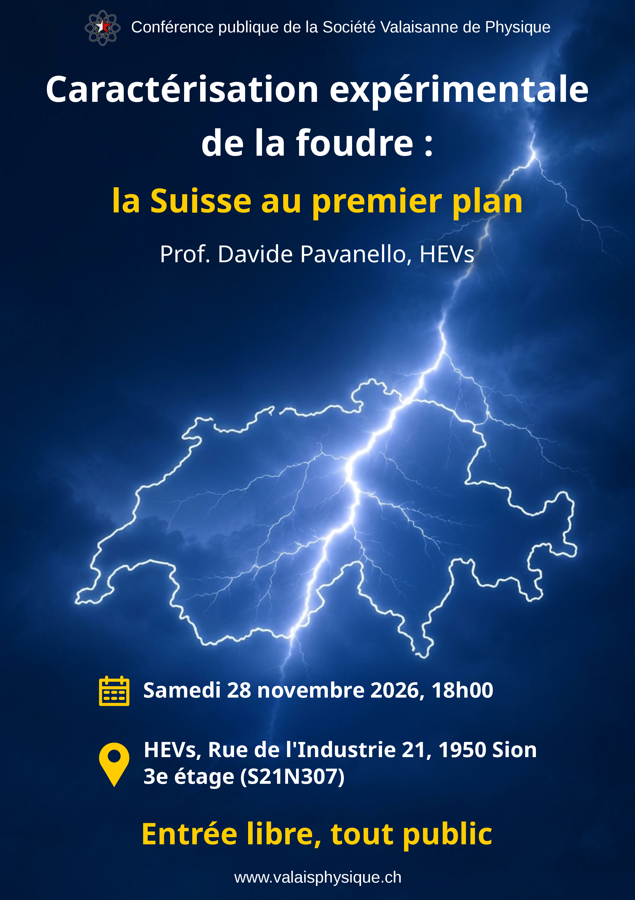

## Conférence, samedi 28 novembre, 19h

HES-SO Valais-Wallis, Campus Energypolis \
[Rue de l'Industrie 21, 1950 Sion](https://maps.app.goo.gl/HffDpiFsoqz7H5vTA) \
Salle 21N307 (3e étage, entrée par le côté sud du bâtiment)

### [Prof. Davide Pavanello](https://www.hevs.ch/en/collaborateurs/pavanello-1646), HES-SO Valais-Wallis

À partir des travaux pionniers du Prof. Berger (ETH Zurich), qui mit en place dans les années 1950 les premières campagnes de mesure de la foudre au Monte San Salvatore, près de Lugano, la Suisse s'est imposée comme une référence mondiale dans la caractérisation expérimentale des décharges orageuses. Plus récemment, les recherches menées par les Professeurs Farhad Rachidi (EPFL) et Marcos Rubinstein (HEIG-VD) au cours de près de quatre décennies ont conduit à des avancées majeures dans la compréhension de ce phénomène aussi fascinant que complexe. Aujourd'hui, l'une des stations de mesure de la foudre les plus réputées au monde est située au mont Säntis, en Appenzell. Frappé en moyenne une centaine de fois par an, ce site exceptionnel alimente une base de données unique permettant de valider des modèles et des hypothèses fondamentaux, contribuant ainsi à une meilleure compréhension de la physique de l'électricité atmosphérique.

