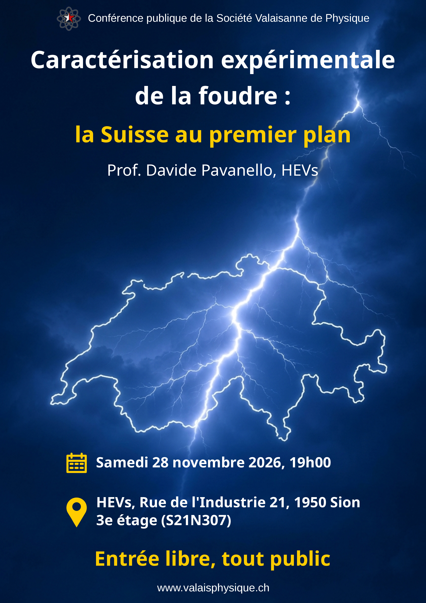

Bienvenue sur le site internet de la Société Valaisanne de Physique!

La prochaine activité est une [conférence du Prof. Davide Pavanello sur la foudre](/Conférence_Pavanello_Foudre) le **samedi 28 novembre 2026**.

Les autres activités récentes de la Société:
- une viste au [Centre de recherche du Grimsel](https://grimsel.com/) en juin 2026,
- [une conférence sur la neige](/Conférence_Huwald_Neige) en mai 2026,
- [une autre sur la physique quantique](/Conférence_Brunner_Physique_quantique) en novembre 2025.

